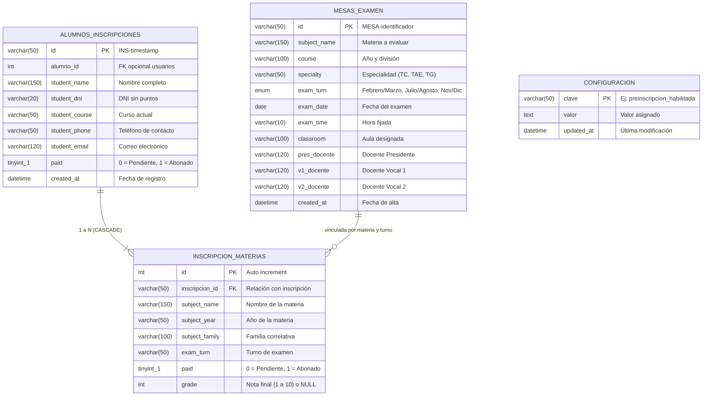

# Documentación Interna — Sistema de Preinscripción a Mesas de Examen
**Escuela de Educación Técnica N° 2 "Independencia" — Anexo Formación Profesional**

---

## 1. Visión General del Sistema

El módulo de **Preinscripciones a Mesas de Examen** gestiona el ciclo completo de evaluación de asignaturas previas, libres y equivalencias para los estudiantes de la E.E.T. N° 2. 

El sistema interactúa de manera directa con el **Campus Virtual**, compartiendo el motor de sesiones, las credenciales institucionales y la base de datos unificada (`campusdigitaldb`).

### Ciclo de vida operativo:
```
[Directivo abre período] 
       │
       ▼
[Alumno se preinscribe a materias previas (máx. 2 materias para regulares)]
       │
       ▼
[Directivo valida el cobro del arancel de examen (Marca Abono = 1)]
       │
       ├─► [Bloqueo Automático]: Alumno ya no puede editar ni borrar la solicitud.
       │
       ▼
[Directivo programa la Mesa con Tribunal Docente (Presidente + 2 Vocales)]
       │
       ▼
[Generación de Actas Volantes Oficiales e Impresión (Individual, Seleccionadas o Todas)]
       │
       ▼
[Carga de Calificaciones finales por parte del Tribunal]
```

---

## 2. Arquitectura de Archivos y Responsabilidades

```text
preinscripciones/
├── index.php                        # Enrutador inteligente según rol de sesión
├── alumnos.php                      # Portal interactivo para estudiantes
├── administrativo.php               # Panel de control institucional para directivos
├── conexion.php                     # Capa de enlace con sesión del Campus y PDO
├── api.php                          # Backend API REST (JSON) y reglas de negocio
├── database.sql                     # Script DDL de tablas y datos semilla
├── styles.css                       # Hojas de estilo unificadas y reglas @media print
├── imagenes/                        # Logotipos y escudos en alta resolución
└── src/
    └── js/
        ├── core.js                  # Utilidades comunes (DOM, formateo, modales)
        ├── tema.js                  # Manejo de tema institucional (Dark / Gold)
        ├── assets.js                # Escudos y membretes en Base64 para PDF
        ├── alumnos.bundle.js        # Lógica del formulario de alumno y validaciones
        └── administrativo.bundle.js # Lógica del panel directivo y generador de actas
```

### Detalle de Componentes Principales

#### `index.php`
Punto de entrada. Evalúa la sesión activa mediante `usuario_mesas()`:
* Si es **directivo** $\rightarrow$ redirige a `administrativo.php`.
* Si es **alumno** $\rightarrow$ redirige a `alumnos.php`.
* Si no hay sesión o es inválida $\rightarrow$ redirige al login del Campus (`campus/login.php`).

#### `alumnos.php`
Interfaz donde el alumno:
1. Visualiza sus datos personales (nombre, DNI y correo tomados directamente de la sesión institucional, no editables para evitar suplantaciones).
2. Selecciona su curso actual y las asignaturas que adeuda.
3. Si el abono ya fue registrado por directivos (`paid = 1`), la interfaz se bloquea automáticamente:
   * Los botones de edición y eliminación se ocultan.
   * Se despliega el banner verde de confirmación oficial con icono de verificación.
   * Se habilita la descarga o impresión de su comprobante / permiso de examen.

#### `administrativo.php`
Panel integral para directivos organizado en módulos:
* **Métricas y Resumen:** Contadores en tiempo real de inscriptos, materias adeudadas, porcentaje de abonos y mesas programadas.
* **Gestión de Inscripciones:** Búsqueda en vivo por DNI/nombre, filtros por curso y estado de pago, confirmación de arancel (marcar abono) y carga de notas finales.
* **Programación de Mesas:** Creación y asignación de tribunales docentes (Presidente, Vocal 1, Vocal 2), aulas, fecha y turno.
* **Generador de Actas Volantes:** Herramienta de emisión de actas oficiales con 3 modalidades de descarga e impresión.

#### `api.php`
Controlador REST que atiende peticiones AJAX/Fetch. Respeta el principio de privilegio mínimo:
* **Acciones públicas (requieren sesión de alumno o directivo):** `status`, `test_connection`, `get_mesas`, `save_enrollment`, `get_config`.
* **Acciones restringidas (exclusivas de directivo):** `create_mesa`, `save_mesa`, `delete_mesa`, `clear_enrollments`, `update_payment`, `update_grade`, `save_config`.

#### `conexion.php`
Provee las funciones puente:
* `conectar()`: Retorna la instancia singleton de `PDO` conectada a `campusdigitaldb`.
* `usuario_mesas()`: Valida la sesión del Campus y recupera los datos verificados del usuario en la base de datos.
* `exigir_peticion_propia()`: Protección anti-CSRF validando el encabezado `X-Requested-With: preinscripciones`.

---

## 3. Modelo de Base de Datos (MySQL)



---

## 4. Reglas de Negocio Implementadas

### 4.1. Límite Reglamentario de Materias Previas
* **Alumnos Regulares (1° a 7° Año):** Solo se permite la inscripción a un **máximo de 2 materias previas** por llamado.
* **Alumnos Egresados:** Sin límite numérico (se detecta automáticamente si el curso contiene la palabra *"Egreso"* o *"Egresad"*).

### 4.2. Bloqueo Transaccional por Abono Confirmado
Para garantizar la integridad contable y administrativa:
1. Cuando un alumno envía su preinscripción, se crea con `paid = 0`. En este estado, el estudiante puede corregir datos o eliminar su solicitud.
2. Una vez que el directivo confirma el arancel desde la interfaz de cobros (`update_payment` con `paid = 1`):
   * Se actualiza `alumnos_inscripciones.paid = 1` y todos los registros en `inscripcion_materias.paid = 1`.
   * En `api.php`: Las peticiones de actualización (`save_enrollment`) o eliminación de inscripciones abonadas son interceptadas y rechazadas con código **HTTP 403**.
   * En `alumnos.php`: Se detecta el estado y se inyecta `window.INITIAL_IS_PAID = true`, deshabilitando el formulario e impidiendo cualquier modificación visual o por script.

### 4.3. Generación Oficial de Actas Volantes
Cada mesa genera un documento de **2 páginas reglamentarias**:
1. **Página 1 (Acta Volante Principal):** Membrete oficial de la escuela, datos de la mesa, tribunal docente, nómina de alumnos inscriptos con casilleros para nota escrita, oral, promedio (números y letras) y estado de arancel.
2. **Página 2 (Acta de Desaprobados):** Planilla complementaria oficial donde se registran los estudiantes que no alcanzaron la nota mínima de aprobación.

#### Modos de Exportación / Impresión:
* **Mesa Individual:** Selecciona una mesa del desplegable y genera el PDF de sus 2 páginas.
* **Marcar Mesas a Descargar:** Despliega una lista con casillas de verificación, buscador y contador en vivo de páginas resultantes.
* **Todas las Mesas a la Vez:** Consolida la totalidad de las mesas del llamado en un **único documento PDF continuo**, respetando el diseño oficial de 2 carillas por mesa sin alterar saltos de página.

---

## 5. Medidas de Seguridad y Protección

1. **Anti-CSRF (Cross-Site Request Forgery):**
   * Toda petición mutadora (POST) enviada a `api.php` exige el encabezado HTTP:
     ```http
     X-Requested-With: preinscripciones
     ```
   * Peticiones externas no autorizadas o provenientes de scripts de terceros son bloqueadas con **HTTP 403**.
2. **Prevención de Inyección SQL:**
   * 100% de las consultas utilizan sentencias preparadas con parámetros tipados (`PDO::prepare()` y marcadores `?`).
3. **Validación de Identidad Estricta:**
   * El DNI del alumno en `api.php` no se confía al cuerpo de la petición: se extrae obligatoriamente del token de sesión verificado en el Campus (`$_SESSION['dni']`).
4. **Sanitización de Entradas:**
   * Las funciones auxiliares aplican `strip_tags()` y límites de longitud de caracteres (`mb_substr`) para neutralizar intentos de XSS persistente.
5. **Políticas de Sesión:**
   * Cookies configuradas con directivas `HttpOnly`, `SameSite=Lax` y control estricto de expiración de caché (`no-store, no-cache, must-revalidate`).

---

## 6. Endpoints de la API (`preinscripciones/api.php`)

| Endpoint (`action`) | Método | Permiso Requerido | Descripción |
|---|---|---|---|
| `status` | GET | Cualquiera | Verifica estado del servicio y conexión a la base de datos |
| `get_config` | GET | Cualquiera | Obtiene estado de habilitación y fechas del período de examen |
| `get_mesas` | GET | Cualquiera | Lista mesas de examen programadas |
| `save_enrollment` | POST | Alumno / Directivo | Crea o actualiza una preinscripción (bloqueado si `paid = 1`) |
| `get_enrollments` | GET | Directivo | Lista inscripciones completas con materias y filtros |
| `update_payment` | POST | Directivo | Marca o desmarca el abono del alumno o materia individual |
| `update_grade` | POST | Directivo | Registra o rectifica la calificación final de un examen |
| `create_mesa` / `save_mesa` | POST | Directivo | Crea o actualiza los datos y tribunal de una mesa de examen |
| `delete_mesa` | POST | Directivo | Elimina una mesa programada |
| `save_config` | POST | Directivo | Actualiza el estado y fechas del período de preinscripción |
| `clear_enrollments`| POST | Directivo | Purgado masivo administrativo de inscripciones |

---

## 7. Mantenimiento y Extensión

### Compilación y modificación de Bundles
Los scripts de frontend se encuentran modularizados en `src/js/`:
* Si se edita `src/js/alumnos.bundle.js` o `src/js/administrativo.bundle.js`, las páginas PHP cargan automáticamente el parámetro de versión por `filemtime(__FILE__)` para invalidar la caché del navegador de los usuarios de inmediato.

### Replicación en Servidor de Producción
Al clonar o migrar el sistema:
1. Asegurar que las extensiones `pdo_mysql` y `mbstring` estén activas en `php.ini`.
2. Verificar que `campus/includes/config.php` contenga las credenciales correctas (`DB_HOST`, `DB_NAME`, `DB_USER`, `DB_PASS`).
3. El archivo `database.sql` puede ejecutarse en caso de inicializar una base de datos limpia.
